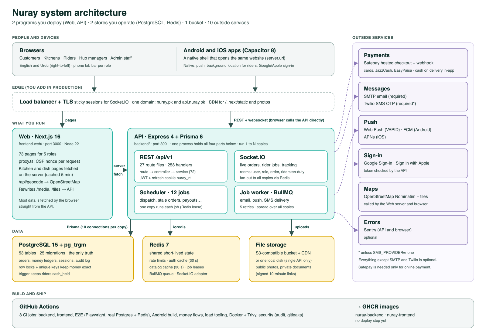

# System design

How Nuray is built, how a request moves through it, which services it depends on, and what has to change to serve more people. Checked against the code on 2026-11-09 (main at 234b19f plus the open settings PR #93).

For module-level detail see [ARCHITECTURE.md](ARCHITECTURE.md). Some of its points are older than this file: where they disagree, this file matches the code (see [What changed since ARCHITECTURE.md](#what-changed-since-architecturemd)).



The diagram's source is [diagrams/system-architecture.html](diagrams/system-architecture.html). To redraw the PNG after editing it:

```bash
cd frontend-web && npx playwright screenshot --viewport-size=1600,1100 --full-page ../docs/diagrams/system-architecture.html ../docs/diagrams/system-architecture.png
```

## The system in one paragraph

Nuray is a marketplace for home kitchens in Karachi and Lahore. Customers order, kitchens cook, riders deliver (including cash on delivery), hubs hold frozen stock, and staff run it from an admin area. There are **two server programs**: a Next.js website and an Express API. They sit on **two data stores**: PostgreSQL holds every business fact and Redis holds shared short-lived state. The Android and iOS apps are thin native shells that open the same website. Everything else is an outside service: payments, SMS, email, push, maps and error tracking.

## How many services

### What you run (yours)

| # | Service | Code | Port | What it does | Can you run several? |
|---|---|---|---|---|---|
| 1 | **API** (Express 4, Node 22, TypeScript) | `backend/` | 3001 | REST API under `/api/v1` (27 route files, 258 handlers), the Socket.IO server, 12 scheduled jobs and the BullMQ job worker. All of this runs in **one process**. | Yes, once Redis and S3 storage are set (see [Scaling](#scaling)) |
| 2 | **Web** (Next.js 16, React 19) | `frontend-web/` | 3000 | Renders the 73 pages for all five roles, sets the CSP, and proxies `/media`, `/files` and geocoding | Yes, with the caveats under [Scaling](#scaling) |
| 3 | **PostgreSQL 15+** with `pg_trgm` | `backend/prisma/` | 5432 | 53 tables, 25 migrations; the only source of truth | One primary today (no replicas) |
| 4 | **Redis 7+** | `backend/src/config/redis.ts` | 6379 | Rate limits, auth and catalog caches, job leases, the BullMQ queue, Socket.IO fan-out | One instance; required in production |
| 5 | **File storage**: a local disk, or any S3-compatible bucket plus a CDN | `backend/src/storage/` | – | Dish photos (public), receipts, documents and chat media (private, signed links) | S3 is required for more than one API instance |

The **mobile apps** (`mobile/`, Capacitor 8) are not a service: they are installed on phones and load the website from `NURAY_APP_URL`.

So, in production: **2 programs you deploy** (API, Web), **2 stores you operate** (Postgres, Redis), and **1 bucket** (or a shared disk).

### Outside services (theirs)

| Service | Used for | Needed in production? |
|---|---|---|
| **Safepay** | Online payment for orders and wallet top-ups (cards, JazzCash, EasyPaisa through Safepay's hosted page), with a signed webhook | Only if online payment is offered. Without it the app takes cash on delivery and manual transfer only. JazzCash and EasyPaisa direct gateways exist as files but refuse every request (not built). |
| **Email over SMTP** (Gmail or any SMTP) | Verification, password reset and notification emails, sent from the job queue | **Yes**: the API refuses to start in production without it |
| **Twilio** | Phone OTP by SMS | **Yes**, unless `SMS_PROVIDER=none` |
| **Google Sign-In** / **Sign in with Apple** | Social sign-in on the web and in the apps | Optional |
| **Web Push (VAPID)**, **Firebase Cloud Messaging**, **Apple Push** | Notifications to browsers, Android and iOS | Optional; each is on when its keys are set |
| **OpenStreetMap Nominatim** and **OSM tiles** | Address search and reverse lookup (through the website's own `/api/geocode`), and map tiles | Works on the public servers, but their usage policy is about one request a second: real traffic needs a paid or self-hosted geocoder and tile server |
| **Sentry** (or GlitchTip) | Error reports from the API and the browser | Optional |
| **GitHub Actions**, **GitHub Container Registry** | CI (8 jobs) and the `nuray-backend` / `nuray-frontend` images | For building, not for running |

That is **10 outside services**, counting push as three and maps as one: Safepay, SMTP, Twilio, Google, Apple, Web Push, FCM, APNs, OpenStreetMap and Sentry. Two of them (SMTP, Twilio) are required in production, and Safepay is required for online payment.

## File structure

```
frozen-nuray/
├── backend/                     API (Express + Prisma)
│   ├── src/
│   │   ├── index.ts             startup: env check → Sentry → middleware → routes → Socket.IO → jobs; graceful shutdown
│   │   ├── config/        (6)   env validation, Prisma client, Redis, Socket.IO server, Sentry
│   │   ├── routes/       (27)   URL → auth/role checks → rate limit → Zod validation → controller
│   │   ├── controllers/  (31)   read the request, call a service, shape the response
│   │   ├── services/     (72)   all business rules: orders, payments, dispatch, payouts, ledgers, auth, notifications…
│   │   ├── validators/   (21)   Zod schemas for every request body and query
│   │   ├── middleware/   (10)   auth, staff permissions, audit log, rate limits, request id, error handler
│   │   ├── gateways/      (6)   payment adapters (Safepay works; JazzCash/EasyPaisa/bank are stubs)
│   │   ├── jobs/          (4)   in-process scheduler with Redis leases, BullMQ queue, email/notify jobs
│   │   ├── storage/       (5)   local disk or S3 driver, signed private links
│   │   └── utils/        (50)   JWT, refresh cookie, caches, money maths, FCM/APNs clients, logger
│   ├── prisma/                  schema.prisma (53 models), migrations/ (25), README for migration rules
│   ├── scripts/                 admin tools, money-flow verifier, load-test harness (scripts/load)
│   └── tests/                   Jest unit and integration tests
├── frontend-web/                Website (Next.js 16 App Router)
│   ├── app/                     73 pages: public + customer (23), auth (7), sellers (13), riders (3), hub (1), admin (26); api/ (geocode, CSP reports)
│   ├── components/              104 components: layout (shells, PhoneTabBar), account, orders, sellers, riders, hubs, admin, ui
│   ├── lib/                     api-client (tokens + refresh), services/, stores (zustand), realtime socket, i18n (English/Urdu, RTL), tab bars, CSP
│   ├── proxy.ts                 per-request CSP nonce (Next 16's middleware)
│   └── tests/                   35 unit files (node --test), 20 Playwright specs
├── mobile/                      Capacitor shell for Android and iOS (opens the website)
│   ├── android/ ios/            native projects
│   ├── capacitor.config.ts      app id pk.nuray.app, server.url, allowed hosts
│   └── www/                     offline page only
├── docs/                        guides; this file; diagrams/
├── docker-compose.yml           local: API + Web containers (Postgres and Redis run on the host)
└── .github/workflows/           ci.yml (8 jobs), docker-publish.yml (images to GHCR)
```

### How the backend code is layered

```
request → route (auth, role, rate limit, Zod) → controller → service → Prisma → PostgreSQL
                                                      ├→ Redis (caches, limits, queue)
                                                      ├→ socketManager.emit… (live updates)
                                                      └→ queue.add (email, push, SMS)
```

Services hold all the rules; controllers stay thin. A service that changes money or an order's state locks the order row (`SELECT … FOR UPDATE`) inside a transaction before it writes.

## How it works

### Loading a page

1. The phone or browser asks the **Web** server for a page. `proxy.ts` gives each request a fresh CSP nonce, and the root layout reads the language cookie (`nuray_locale`) to set `lang` and `dir`.
2. 63 of the 73 pages are client components: the server sends the shell, and the browser fetches data from the **API** directly. Only the kitchen and dish pages (`kitchens/[id]`, `products/[id]`) fetch on the server first, cached for 5 minutes, so links preview well.
3. Every API call goes through `lib/api-client.ts`, which adds `Authorization: Bearer <access token>`.

### Signing in and staying signed in

- Sign-in returns a short access token (1 hour), which the page keeps **in memory only**, and sets a refresh token (30 days) as an **httpOnly cookie** `nuray_rt`. The cookie is limited to `/api/v1/auth`, `SameSite=Lax`, and `Secure` in production.
- After a reload the page has no access token, so it calls `/auth/refresh`; the cookie goes along automatically. Each refresh **rotates** the token. If an old token is used again more than 30 seconds later, the whole session is ended (theft detection).
- On every request the API checks the token, then the user's status and the session in a **30-second Redis cache** (`auth:user:*`, `auth:sid:*`). Signing out, a suspension or a password change overwrites those keys, so the change applies at once on every instance.
- Website and API must be on the **same registrable domain** (for example `nuray.pk` and `api.nuray.pk`), or phones treat the cookie as third-party and drop it.

### Placing an order (the main write path)

1. The checkout sends the basket with an `Idempotency-Key`. `orders` has `UNIQUE(customer_id, idempotency_key)`, so a retry returns the first order instead of a second one.
2. Stock is taken with a conditional update (`stock_quantity >= qty`), so it never goes below zero.
3. Online payment goes to Safepay's hosted page. The return URL and the webhook both settle the same `payment_attempts` row once (`tracker` is unique, and the row is locked).
4. The kitchen is told live through Socket.IO (`order:new`) and by push. Accept, prepare and ready are each a compare-and-set on the current status.
5. When the order is ready, **dispatch** offers the job to on-duty riders (`riders:on-duty` room). A claim is `UPDATE … WHERE rider_id IS NULL`, so only one rider gets it. A rider holding more cash than their limit cannot take cash jobs. Cash held is kept in `riders.cash_held` by a **database trigger** on the rider ledger.
6. Delivery ends with an OTP or handover code. The ledgers are posted in the same transaction: the platform's double-entry ledger, the rider ledger (one row per delivery and type), and the kitchen's balance, which is calculated from its orders when needed.

### Live updates

- One Socket.IO connection per open tab, using the access token. Rooms: `user:<id>`, `role:<type>`, `session:<sid>`, `order:<id>`, `riders:on-duty`.
- With Redis set, `@socket.io/redis-adapter` passes every emit to all API instances, so the instance that changed an order does not need to be the one holding the customer's socket.
- Pages also re-read on a safety timer (30 to 120 seconds) and after a reconnect, so a missed event is not lost.

### Background work

- **Scheduled jobs** (12, in `backend/src/index.ts`): dispatch waiting orders (every 60 s), sweep stale orders (2 min), expire payment attempts (15 min), ranking scores (15 min), ops snapshot (5 min), hub batch expiry and weekly payouts (1 h), stock alerts, secrets purge, kitchen owing and refresh-token pruning (6 h), audit retention (24 h). Every instance runs the timers, but each run first takes a **Redis lease** (`lock:job:<name>`), so only one instance does the work.
- **Queued jobs** (BullMQ queue `nuray-jobs`): emails and notification delivery (push, email, SMS), with 5 attempts and backoff. Every instance runs a worker, so the work spreads out.

## Data design

53 tables, no Prisma enums (statuses are strings, some limited by SQL `CHECK`s), UUID keys, money as `Decimal(12,2)`.

| Area | Tables |
|---|---|
| Users and sign-in (9) | users, profiles, addresses, OTPs, email verifications, password resets, refresh tokens (session families), staff two-factor, favourite kitchens |
| Kitchens and menu (12) | sellers, seller documents, categories, category requests, products, images, tags, variants, stock alerts, carts, cart items, inventory reservations |
| Orders (4) | orders, order items, status history, order messages |
| Delivery, riders, hubs (9) | riders, deliveries, rider documents, rider ledger, hub centres, hub inventory, inventory log, temperature log, batch allocations |
| Money (7) | wallets, wallet transactions, payment attempts, platform ledger, refunds, seller payouts, payout schedules |
| Other (12) | promotions and usages, reviews, notifications and push subscriptions, support tickets and messages, audit log (append-only, by trigger), system settings, communities, community pair fees, kitchen-to-community delivery |

What keeps the money right:
- Duplicate-proof keys: `orders(customer_id, idempotency_key)`, `payment_attempts.tracker`, `rider_ledger_entries(delivery_id, type)`, `promotion_usages(promotion_id, order_id)`, `notifications.dedupe_key`.
- Row locks on `orders`, `riders`, `sellers` and `hub_inventory` before money or stock moves; advisory locks per cart and per hub batch.
- `CHECK`s for non-negative stock and wallet balance. The audit log rejects updates and deletes, apart from a guarded purge of rows older than 2 years.
- `scripts/verify-money-flows.ts` runs in CI against a real database.

Search uses `pg_trgm` GIN indexes on dish name, Urdu name and description. There is no PostGIS: distances are calculated in code from latitude and longitude columns.

## Scaling

### Where it stands (measured, not estimated)

All on one 8-core laptop with PostgreSQL 15 at `max_connections` 100, from [LOAD_TESTING.md](LOAD_TESTING.md), [PRODUCTION_READINESS_REPORT.md](PRODUCTION_READINESS_REPORT.md) and a run on 2026-11-08:

| Test | Result |
|---|---|
| 1,000 users signing in and ordering | 0 % errors, p95 252 ms |
| 3,000 users | 4.97 % errors, p95 4.8 s |
| 5,000 users, steady, 2 API instances, before #89–#91 | 565 req/s, p95 8.1 s, 0.02 % 5xx |
| 5,000 users, steady, 2 API instances, **with** the auth cache, catalog cache and cash trigger (#89–#91) | 654 req/s, p95 4.9 s, 0.08 % 5xx |
| 10,000 users | **Not achieved.** The last attempt (before #89–#91) failed with 66 % errors. |
| Correctness under races | 1,000 simultaneous orders: no duplicates and stock never negative; 20 riders on one job: one winner |

The limit on one machine was the **database side**: the connection pool, ranked search, listing counts and the per-rider cash check (now replaced by the trigger). It was not Node.

### What is already shared, and what is not

Shared across API instances (safe to add instances):
- **Postgres**: every business fact, sessions, audit.
- **Redis**: rate limits, auth and catalog caches, attempt budgets, job leases, the job queue and Socket.IO fan-out.

Still **per instance** (fix or accept before running many):

| Item | Where | Effect with N instances | Fix |
|---|---|---|---|
| Local file storage | `STORAGE_DRIVER=local` | A photo saved on instance A is missing on B | Set `STORAGE_DRIVER=s3` with a bucket and CDN |
| Delivery price cache (60 s) | `services/delivery-pricing.service.ts` | An admin price change can take 60 s to reach other instances | Move it to the Redis catalog-cache pattern |
| Dish view counter | `services/product.service.ts` | Up to 30 s of views lost if an instance crashes | Accept, or count in Redis |
| Socket event limit (120/min) | `config/socket.ts` | Becomes N × 120 per user | Move the counter to Redis |
| Geocoding cache, queue and per-IP limit | `frontend-web/lib/geocode-proxy.ts` | N web servers send N times the 1 req/s Nominatim allows | Paid or self-hosted geocoder |
| Next.js data cache (kitchen/dish pages) | each web container | Each replica fetches separately | Fine at small N; a shared cache handler later |
| Socket.IO polling fallback | load balancer | Long-polling breaks without sticky sessions | Sticky sessions, or websocket-only |

### A path to more users

Each stage keeps the same code. It changes what runs where, and each step has to be measured, not assumed.

**Stage 1: first real launch (one region, a few thousand users at once)**
- 2 to 4 API instances and 2 web instances behind a load balancer that terminates TLS, with sticky sessions for Socket.IO.
- Managed PostgreSQL (with point-in-time recovery) and managed Redis, both in the same region as the servers.
- `STORAGE_DRIVER=s3` with a CDN in front (`ASSET_BASE_URL`).
- Website and API on one domain (`nuray.pk` / `api.nuray.pk`).
- Keep `instances × connection_limit + 10 ≤ max_connections`.
- Add what the repo does not have yet: infrastructure as code, a deploy step for the GHCR images, backups, and metrics. Today the only metric is the 5-minute `ops_snapshot` log line.

**Stage 2: towards 10,000 at once**
- Give PostgreSQL its own large machine and raise `max_connections`. Only add a pooler (PgBouncer 1.21+ with `max_prepared_statements`, **not** `pgbouncer=true`) once instances × pool exceeds what Postgres allows. On one machine it made things slower (532 → 378 req/s).
- Add a **read replica** for the heavy reads: search, listings, kitchen dashboards, admin reports. Prisma needs a second client or the read-replicas extension for this, which is a code change.
- Fix the hot spots named in the readiness report: page the rider job pool, add a trigram index on `sellers.business_name`, keep the kitchen balance as a snapshot instead of summing every past order, and cache `requireSeller`.
- Run the load ladder again after each change. 10,000 is a target, not a measured result.

**Stage 3: beyond one database**
- Split the background work onto its own instances (`scheduler + worker`, no HTTP), so a payout run cannot slow checkout. This needs a small change: the jobs start in `index.ts` today.
- Partition the large append-only tables by month: orders history, notifications, audit log, ledgers.
- Use Redis with failover (Sentinel or a managed HA tier); today one Redis outage turns limits off and moves jobs in-process.
- Run a geocoder and tile server of your own, and add more payment providers so Safepay is not a single point.

### Single points of failure today

- **PostgreSQL**: the only gate in the health check; everything stops without it.
- **Redis**: limits fail open, live updates stay on each instance, and queued jobs run in-process without retries.
- **Safepay**: the only online payment path.
- **Public Nominatim and OSM tiles**: rate-limited free services.

## What changed since ARCHITECTURE.md

- Sessions are rotating refresh-token families in `refresh_tokens`, with the refresh token in an httpOnly cookie and the access token in memory (no tokens in browser storage).
- Redis now also holds the auth cache (30 s), the catalog cache (30 s, versioned) and the job leases. Jobs use a Redis lease first and fall back to a Postgres advisory lock only when Redis errors.
- The Socket.IO handshake uses the auth cache rather than reading the database each time.
- `riders.cash_held` is maintained by a trigger.
- A mobile app exists (`mobile/`). It opens the website, uses FCM/APNs push and Sign in with Apple, and Android flushes cookies when the app is paused.
- The website sets an enforced CSP with a per-request nonce (`proxy.ts`), and kitchens and riders have phone tab bars.

## Known gaps

- No infrastructure as code, no deploy job, no backup tooling in the repo.
- No metrics endpoint (only logs and Sentry).
- Role guards on the website are client-side: the API is the real security boundary, but every role's page code is public.
- Every page is rendered per request (the CSP nonce prevents static HTML), so a CDN can cache assets but not pages.
- `NEXT_PUBLIC_*` values are built into the web image: one image per environment.
